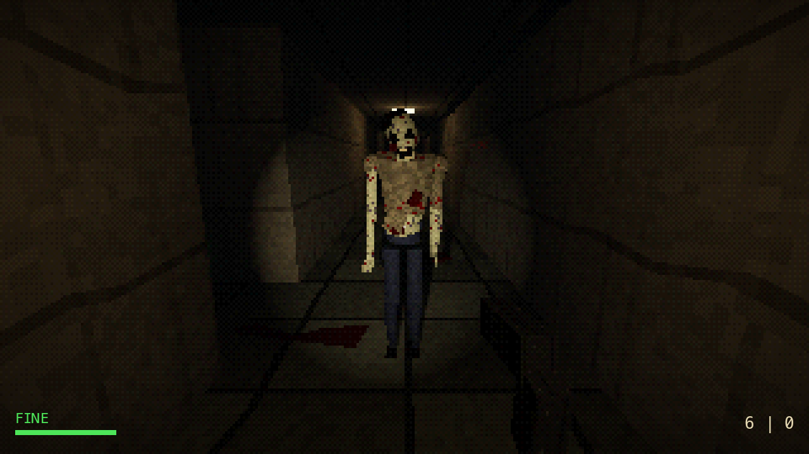
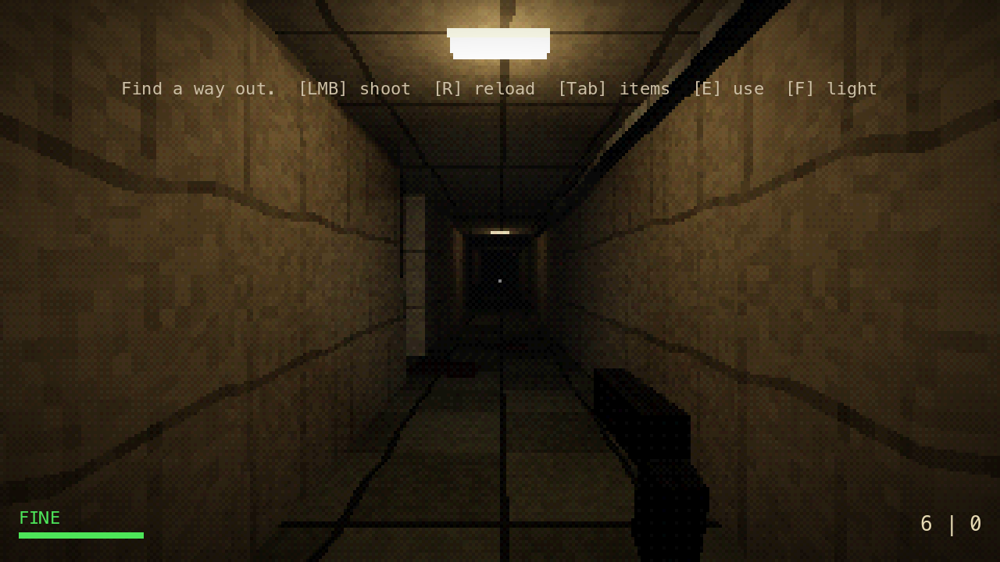
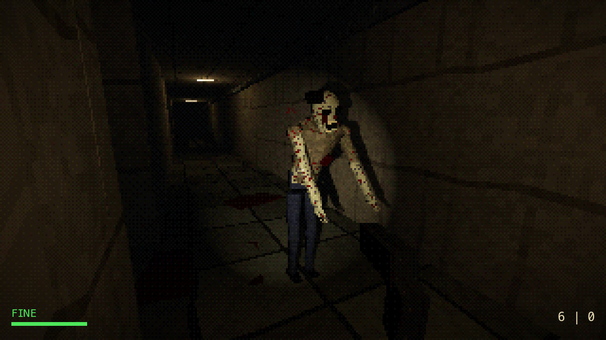
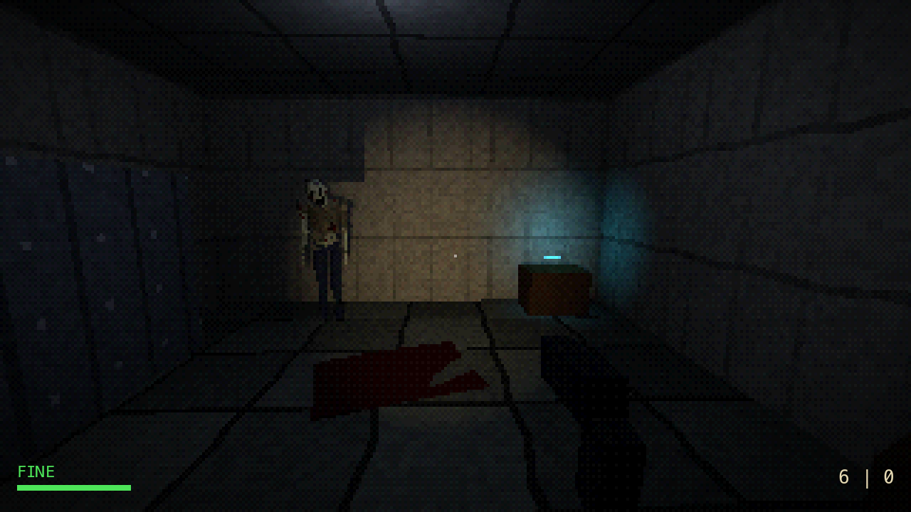
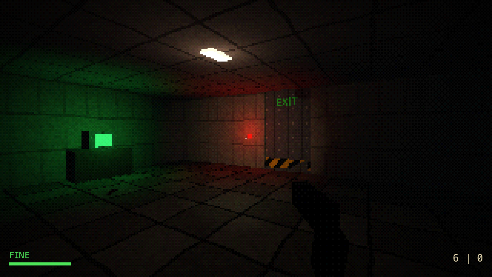
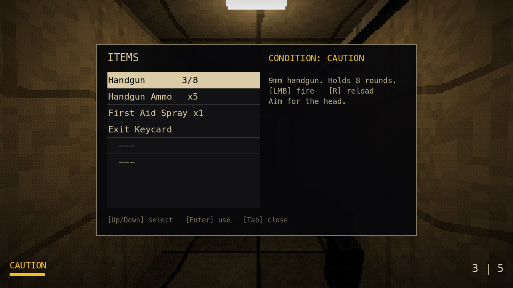
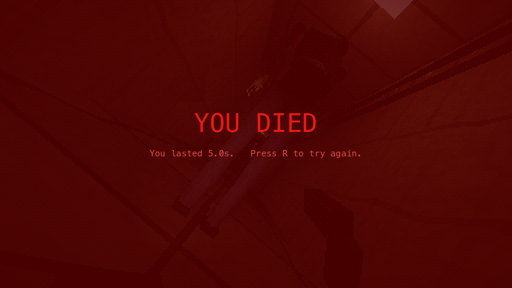

# Deadlock Opus (Godot 4.7 prototype)

Small PS1-style first-person survival horror in the classic Resident Evil mould:
explore three dim rooms, scrounge scarce ammo, decide which zombies are worth a
bullet, find the Exit Keycard and get out.



Run: open the folder in Godot 4.7 and press F5, or
`/Applications/Godot.app/Contents/MacOS/Godot --path .`

## Screenshots
| | |
|---|---|
|  |  |
| *The opening corridor* | *Too close for comfort* |
|  |  |
| *Storage: something guards the keycard* | *The locked EXIT and its keycard reader* |
|  |  |
| *Item screen (pauses the game)* | *Death* |

Captured from the game itself (the 3D view renders at 320×180 and is scaled up). Regenerate them with
`/Applications/Godot.app/Contents/MacOS/Godot --path . --script tools/capture_screenshots.gd`.

## Controls
| Key | Action |
|---|---|
| WASD / arrows, mouse | move, look |
| Shift | run (limited stamina) |
| Left mouse | fire handgun |
| R | reload (also restart after win/death) |
| Tab or I | items (pauses the game) — Up/Down select, Enter use, drag the model to rotate it, Tab/Esc close |
| E | pick up / use door / read terminal |
| F | flashlight |

## Design
- **Handgun** (`scripts/player.gd`): USP viewmodel from the PSX Pistol Pack, drawn with the same PS1
  shader as the world (vertex snapping, affine textures, nearest-neighbour texels). 15-round magazine
  plus a chambered round; starts with 9+1 and none spare. 0.3s between shots. Each shot: 50ms pixel
  muzzle-flash sprite (random rotation) and warm muzzle light, recoil kick, slide cycles. The last
  round locks the slide back; after that the trigger only dry-fires. **Empty reload** (1.6s): empty
  mag drops, full mag seats, slide drops = 15 rounds. **Tactical reload** (1.3s): magazine swap only,
  rounds left in the old mag go back to the reserve = 15 + 1 chambered. R does nothing when full or
  with no spare ammo. Reload and recoil poses step at 15 fps for stiff PS1-style motion; idle sway and
  walk bob. Tuning constants are at the top of `player.gd`. Recorded dry fire, magazine out/in and
  slide rack sounds, each started early so its click lands on the matching animation frame (leads
  and volume in `scripts/sfx.gd`).
- **Zombie model**: built in code from faceted 6-sided limbs (no imported assets): infected facility
  staff in three outfits: a **worker** (orange coveralls, hi-vis bands, dented hard hat, tool belt,
  steel-toe boots, one glove), a **hazmat tech** (torn yellow suit, hood pulled back, respirator hanging
  at the chest, rubber gloves and boots) and a **scientist** (blood-soaked lab coat with flapping
  tails, shirt and tie, ID badge). All have sunken sockets with yellowed, bloodshot eyes and glowing red
  irises, raw lower lids, a hanging jaw with teeth, and the bite that infected them (raw wound, tooth
  marks, black veins spreading out and up the neck): neck for the worker and scientist, forearm
  through a tear in the suit for the hazmat tech. Each zombie randomises which arm reaches and which
  leg drags, plus slight size variation.
- **Zombie animation**: limping, rolling shamble that trips every few seconds (forward lurch, sideways
  stagger, arms flung out to catch itself). Idle zombies sway, buckle at the knees, twitch and
  shuffle round. Get within 4m and they rear back and **scream**, then **lunge** at 2 m/s (vs. 1.3
  shamble, still slower than your 2.6 walk) for up to 2.5s, arms grabbing, carrying the momentum into
  the swing; 6s cooldown between lunges, and a bullet knocks them out of it. Stagger when shot, fall
  back on death.
- **Zombies** (`scripts/zombie.gd`, 5 HP): idle until they see you (9m, in front of them) or you get
  within 3m. Gunshots within 14m draw them to where you fired. They shamble at ~1.3 m/s (you walk
  2.6, run 4.4), lunge when close (above), wind up and hit for 25 at arm's length, stagger when shot, search where they last
  saw you for ~6s and then give up. No speed ramp, no endless chase.
- **Health**: 100. FINE / CAUTION / DANGER in the HUD and item screen, red flash + camera shake on
  hits, heartbeat louder when hurt or when a hostile zombie is near. 0 = death.
- **Items**: one First Aid Kit (+60, carried), two walk-over med kits (+50 on contact, left alone at
  full health), two 5-round ammo boxes (PSX 9mm box model), the Exit Keycard. Both kit types use the
  PSX Med Pack "Health kit" model with a faint self-glow (`MEDKIT_GLOW`); heal amounts are
  `HEAL_AMOUNT` and `MEDKIT_HEAL` at the top of `scripts/main.gd`.
- **Item screen viewer**: the selected item's 3D model (same models as the pickups; the USP for the
  handgun) turns slowly in a half-resolution window under the description. Drag with the mouse to
  rotate it; it resumes spinning 1.5s after you let go.
  Pickups spin and hop with a small landing squash, stepped at 12 fps. Ammo goes to the
  reserve; using it from the item screen closes the screen and starts a reload. The First Aid Kit is refused
  at full health so it can't be wasted.
- **Scarcity**: 20 rounds total vs. 3 zombies × 5 HP. Killing everything is possible but tight;
  avoiding the optional closet zombie is the safe play.

## Level walkthrough (spoilers)
1. Corridor A — ammo box tucked behind the crates. A side closet holds a sleeping zombie and,
   behind it, the First Aid Kit (optional risk/reward).
2. Corridor B → STORAGE room — a zombie guards the Exit Keycard on a crate.
3. Taking the keycard makes the "corpse" lying in corridor B get up.
4. Door room — second ammo box in the corner, terminal log hints at the keycard, red keycard reader
   by the EXIT door. E at the door with the keycard opens it; walk out to win.

## Validation
`tests/playtest.gd` drives the real game in a window with injected keyboard and mouse events
(`Input.parse_input_event`), not direct function calls, except where noted:
```
/Applications/Godot.app/Contents/MacOS/Godot --path . --script tests/playtest.gd [-- /dir/for/screenshots/]
```
Result: **78/78 checks pass.** The test sets `grab_mouse = false` on `main.gd`, so it
never captures your desktop mouse and real mouse movement can't turn the view (the likely cause of
earlier intermittent movement failures). Mouse capture itself is therefore not covered by the test.
not confirmed, possibly real mouse input reaching the test window). Waits and key-holds use simulated physics ticks
and re-send held keys each tick, so the test is stable even when its window is in the background.

**Tested (automated, windowed):**
- Movement: W forward, D strafe, Shift sprint faster, walls block.
- Shooting: left click fires and spends a round, HUD shows "10 / 0", muzzle flash shows and is gone
  after ~50ms, fire-rate limit, last round locks the slide, empty gun dry-fires without using ammo.
- Reloading: blocked with no spare ammo or when full; tactical reload = 16 rounds, empty reload = 15
  with the slide released; both 1.2-1.8s; can't fire mid-reload; pickups into an empty gun only add
  to the reserve.
- Zombie damage: body shot −1, headshot −2, shot alerts zombie, dies at 0 HP, corpse stops blocking.
- Zombie AI: no detection from behind, detection in front at 8m, pursuit ~1.4 m/s, gives up after
  losing the player, attacks at close range for 25, no lunge from far away, screams + lunges when
  close at ~2 m/s and the lunge ends in a hit.
- Health: red flash, FINE/CAUTION/DANGER, First Aid Kit heals +60 via item screen (keyboard).
- Med kits: no [E] prompt, ignored at full health, walking over one heals +50 and removes it, capped
  at 100.
- Inventory: Tab and I open, world is paused while open, lists weapon/ammo/heal/key, 3D item viewer
  shows the selected item and follows the selection, mouse drag rotates it, using ammo closes
  the screen and reloads, heal refused at full health, Tab and Esc close.
- Collection: E picks up ammo (+5), First Aid Kit, Exit Keycard; prompt shown; keycard wakes the corpse.
- Locked door: locked prompt, E without key refuses, door physically blocks, keycard opens it.
- Victory: walking out shows YOU ESCAPED. Defeat: health 0 shows YOU DIED. R restarts.

**Shortcuts the test takes:** it teleports the player/zombies into position and sets some values
directly (e.g. health 30, `has_key = true` for the door test, zombie facing) instead of walking the
whole level. A full start-to-finish run through all rooms was not automated.

**Not verified:**
- A human playthrough: real mouse-look feel, aim difficulty at 320×180, whether the ammo budget
  and zombie damage feel fair, and whether the level is readable without the walkthrough.
- Zombie stumbles and idle shuffles are random, so they were only checked by eye in screenshots.
- Audio: the recorded files load and trigger (ambience loops, gunshot overlaps, lunge sound plays from
  the zombie), checked by script; nobody has listened to the mix, including whether the ambience loop
  point is seamless. The remaining synth sounds (heartbeat, player steps, hit splat, beeps) are generated. Zombies have
  no groan or footstep sounds yet (their `step`/`groan` signals are unconnected hooks).
- Mouse clicks on inventory rows (only keyboard navigation was tested).
- Performance on other machines / other renderers; only this Mac (Godot 4.7.2, Forward+) was run.

## Credits
Audio files live in `audio/`; volume levels are the constants at the top of `scripts/sfx.gd`.
- Ambience: "OldFactoryRooms_Ambience" from the "Old locations - Horror ambiences" pack by Canvas Coven (https://canvas-coven.itch.io/)
- Gunshot: "9mm Single Isolated" from Snake's SECOND Authentic Gun Sounds Pack by SnakeF8 / F8 Studios (https://f8studios.itch.io/snakes-second-authentic-gun-sounds-pack)
  - Reload sounds from the same pack ("& More/Pistol"): "9mm Pistol Dry Fire" (dry_fire.wav), "9mm Pistol Reload 1" (mag_out.wav), "9mm Pistol Reload 2" (mag_in.wav), "9mm Pistol Rack Full" (slide_rack.wav)
- zombie_attack.mp3 – source TBD
- Pistol model: USP from the PSX Pistol Pack by Doctor_sci3nce (https://doctor-sci3nce.itch.io/), licensed CC-BY for non-commercial use.
- Ammo box model: "9mm" box from the PSX Ammo Boxes pack by Doctor_sci3nce (https://doctor-sci3nce.itch.io/)
- First aid kit model: "Health kit" from the PSX Med Pack by Retro Assets Library (https://retroassetslibrary.itch.io/). Free to use and share, but not to be resold.
